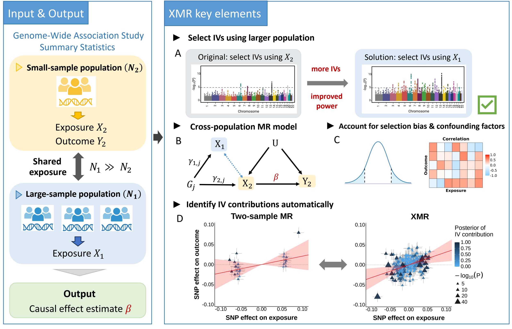

# XMR

**XMR** (Cross-Population Mendelian Randomization) is a probabilistic method for estimating causal effects between an exposure and an outcome using genome-wide summary statistics from multiple populations.

XMR improves the power and robustness of causal inference in underrepresented (small-sample) populations by leveraging information from a large-sample auxiliary population. 
Specifically, XMR decomposes the observed SNP–trait effects into true causal effects and confounding factors (e.g., pleiotropy, population structure) hidden in summary statistics. 
By explicitly modelling the genetic correlation between two populations, XMR effectively borrows strength from the large-sample group. 
XMR further corrects bias introduced by IV selection and LD clumping to reduce false positive rates.

[](https://github.com/user-attachments/files/34630693/method_overview.pdf)

**Overview of the XMR method.** XMR estimates the causal effect $`\beta`$ of exposure $`X_2`$ on outcome $`Y_2`$ in a smaller target population by leveraging GWAS data on the same exposure, $`X_1`$, from a larger auxiliary population. Panels A–C are schematic illustrations; panel D shows fitted results from simulated data.
**(A)** XMR selects candidate IVs using the auxiliary-population exposure GWAS, as indicated by the green check mark. The schematic chromosome plots illustrate how greater precision can allow more SNPs to pass a fixed significance threshold (dashed horizontal lines), potentially increasing power.
**(B)** Diagram of the XMR model. Arrows indicate effects, $`U`$ denotes unmeasured confounding, and $`\gamma_{1,j}`$ and $`\gamma_{2,j}`$ denote population-specific SNP–exposure effects. The blue dashed line represents the cross-population genetic correlation.
**(C)** Selection bias and background correlation. The Gaussian schematic (left) shows the auxiliary exposure Z-score selection thresholds (dashed lines) and retained regions (blue tails), illustrating the IV-selection event on which XMR conditions its likelihood. The heatmap (right) illustrates potential background exposure–outcome correlations due to correlated pleiotropy or sample structure; columns denote exposures, rows denote outcomes, and colors indicate illustrative correlations.
**(D)** MR-APSS, representing two-sample MR (left), and XMR (right), fitted to the same simulated dataset ($`N_{\mathrm{EUR}} = 40{,}000`$, $`N_{\mathrm{EAS}} = 6{,}000`$, $`\rho = 0.8`$, and $`\beta = 0.3`$). Triangles show selected SNPs’ target-population effects $`(\hat{\gamma}_{2,j}, \hat{\Gamma}_{2,j})`$, with gray error bars indicating $`\pm 1`$ SE. Darker blue indicates a higher posterior probability of foreground membership under the fitted model. Triangle size represents $`-\log_{10}(P)`$, using target-exposure P values for MR-APSS and FEMA exposure P values for XMR. Red lines and shaded regions show the causal effect estimates and their 95% confidence intervals.
Schematic elements were created with BioRender.com, with permission.

## Installation

```r
# install.packages("devtools")
devtools::install_github("YangLabHKUST/XMR")
```

Typical installation time: < 5 minutes. Required time on a standard desktop computer should be comparable.

## Usage

We illustrate how to perform cross-population MR analysis using XMR with a real-data example: LDL cholesterol (LDLC, exposure) and myocardial infarction (MI, outcome), with Europeans (EUR) as the auxiliary population and East Asians (EAS) as the target population.

The XMR analysis comprises two main steps:

- **Step 1:** Prepare data, estimate background parameters (the C and Omega matrices via cross-population LD score regression), and select and LD-clump candidate IVs.
- **Step 2:** Fit XMR for causal inference.

For a step-by-step walkthrough, see the [XMR tutorial: causal effect of LDLC on MI](https://htmlpreview.github.io/?https://github.com/YangLabHKUST/XMR/blob/main/XMR_tutorial_LDLC_MI.html) ([download link](https://github.com/YangLabHKUST/XMR/blob/main/XMR_tutorial_LDLC_MI.html)).

For a quick start, you can skip Step 1 and proceed directly to Step 2 using the example data we have prepared.

```r
library(XMR)

exposure <- "LDLC"
outcome  <- "MI"

# Auxiliary-exposure P-value threshold for IV selection
threshold <- 5e-05

# Load example data
data(C)
data(Omega)
data(clumped_data) # after IV selection and LD clumping

# Fit XMR
XMR_res <- fit_XMR(
  data = clumped_data,
  exposure = exposure,
  outcome = outcome,
  C = C,
  Omega0 = Omega,
  Threshold = threshold,
  tol1 = 1e-07,
  tol2 = 1e-07,
  min_thres = 1e-2
)
```

### Input data format

The input `data` should be a data.frame containing the following columns:

| Column | Description |
|--------|-------------|
| `b.exp.pop1` | SNP–exposure effect in the auxiliary population (pop1) |
| `b.exp.pop2` | SNP–exposure effect in the target population (pop2) |
| `b.out.pop2` | SNP–outcome effect in the target population (pop2) |
| `se.exp.pop1` | Standard error of `b.exp.pop1` |
| `se.exp.pop2` | Standard error of `b.exp.pop2` |
| `se.out.pop2` | Standard error of `b.out.pop2` |
| `L2.pop1` | LD score in the auxiliary population; defaults to all ones if not provided |
| `L2.pop2` | LD score in the target population; defaults to all ones if not provided |
| `L12` | Cross-population LD score between pop1 and pop2; defaults to all ones if not provided |

### Parameters related to confounding factors

- **C matrix**: A 3×3 matrix capturing the effects of sample structure (population stratification, cryptic relatedness, sample overlap, etc.).
- **Omega matrix**: A 3×3 variance–covariance matrix of polygenic effects.

Both can be estimated using bivariate LD score regression.

### Expected output

`XMR_res` is a list containing:
- `exposure`: name of the exposure
- `outcome`: name of the outcome
- `beta`: estimated causal effect of the exposure on the outcome
- `beta.se`: standard error of the causal effect estimate
- `beta.pvalue`: p-value for the causal effect
- `tau.sq`: estimated variance of uncorrelated pleiotropic effects
- `SigmaX`: estimated covariance matrix of exposure effects in the foreground component
- `post`: posterior quantities, including `post$Pi`, the posterior foreground-membership probabilities providing model-based support for each candidate IV's contribution to causal estimation
- `nIV`: number of candidate IVs used
- `nvalid`: model-estimated effective IV counts (`pi0 * nIV`)
- `pi0`: estimated foreground proportion among selected candidate IVs
- `Threshold`: auxiliary-exposure P-value threshold used for IV selection
- `fit1_elbos`, `fit2_elbos`: evidence lower bounds in the two fitting stages
- `fit1_likelis`, `fit2_likelis`: likelihoods in the two fitting stages

For the LDLC → MI example, the expected output is approximately:
- `beta` = 0.1830, `beta.se` = 0.0449, `beta.pvalue` = 4.5902e-05, `nIV` = 289, `nvalid` = 168.9770

**Expected run time**: ~1 minute on an Intel® Xeon® Gold 6152 CPU @ 2.10 GHz. Run time on a standard desktop computer should be comparable.


## Reproducibility

We evaluated XMR and comparison methods across five experimental settings:

- **Simulations**: evaluating method performance under baseline and reduced-confounding scenarios.
- **Negative-control studies**: testing the causal effects of 35 traits on 2 negative-control outcomes (skin tanning ability and natural hair color) in Africans (AFR) and Central/South Asians (CSA).
- **Auxiliary-dataset sensitivity**: comparing FinnGen and Pan-UKB as auxiliary datasets for analyses in BioBank Japan (BBJ).
- **SHBG–T2D analysis**: estimating the effect of sex hormone-binding globulin on type 2 diabetes across populations.
- **BBJ–TPMI analysis**: comparing causal estimates across BBJ, the Taiwan Precision Medicine Initiative (TPMI), and UK Biobank (UKBB).

Source code for the main-figure analyses is available at [YangLabHKUST/XMR_reproduce](https://github.com/YangLabHKUST/XMR_reproduce). Experiment scripts and visualization scripts are provided separately.

**Simulations:**

[Baseline experiments](https://github.com/YangLabHKUST/XMR_reproduce/tree/main/simulations/code/baseline) |
[Reduced-confounding experiments](https://github.com/YangLabHKUST/XMR_reproduce/tree/main/simulations/code/reduced_confounding) |
[Workflow](https://github.com/YangLabHKUST/XMR_reproduce/blob/main/simulations/README.md) |
[Result summaries](https://github.com/YangLabHKUST/XMR_reproduce/tree/main/simulations/plot)

**Negative-control studies:**

[Experiments](https://github.com/YangLabHKUST/XMR_reproduce/tree/main/negative_controls/code) |
[Workflow](https://github.com/YangLabHKUST/XMR_reproduce/blob/main/negative_controls/README.md) |
[Visualization](https://github.com/YangLabHKUST/XMR_reproduce/tree/main/negative_controls/plot)

**Auxiliary-dataset sensitivity:**

[Experiments](https://github.com/YangLabHKUST/XMR_reproduce/tree/main/auxiliary_sensitivity/code) |
[Workflow](https://github.com/YangLabHKUST/XMR_reproduce/blob/main/auxiliary_sensitivity/README.md) |
[Visualization](https://github.com/YangLabHKUST/XMR_reproduce/tree/main/auxiliary_sensitivity/plot)

**SHBG–T2D analysis:**

[Experiments](https://github.com/YangLabHKUST/XMR_reproduce/tree/main/SHBG_T2D/code) |
[Workflow](https://github.com/YangLabHKUST/XMR_reproduce/blob/main/SHBG_T2D/README.md) |
[Visualization](https://github.com/YangLabHKUST/XMR_reproduce/tree/main/SHBG_T2D/plot)

**BBJ–TPMI analysis:**

[Experiments](https://github.com/YangLabHKUST/XMR_reproduce/tree/main/BBJ_TPMI/code) |
[Workflow](https://github.com/YangLabHKUST/XMR_reproduce/blob/main/BBJ_TPMI/README.md) |
[Visualization](https://github.com/YangLabHKUST/XMR_reproduce/tree/main/BBJ_TPMI/plot)

### Setup

Follow the steps below to prepare the inputs and run the analyses.

#### 1. Clone the reproduction repository

```bash
git clone https://github.com/YangLabHKUST/XMR_reproduce.git
cd XMR_reproduce
```

Directory structure:

```text
XMR_reproduce/
├── simulations/            # Baseline and reduced-confounding simulations
├── negative_controls/      # Negative-control analysis in AFR and CSA
├── auxiliary_sensitivity/  # FinnGen and Pan-UKB auxiliary datasets
├── SHBG_T2D/               # SHBG–T2D analysis across populations
├── BBJ_TPMI/               # BBJ–TPMI–UKBB comparison
├── environment/            # Software dependencies and versions
└── DATA.md                 # Input formats and file locations
```

Each experiment directory contains separate `code/` and `plot/` folders.

#### 2. Download and prepare GWAS data

Download the raw GWAS summary statistics from the sources listed in [Supplementary data.xlsx](https://github.com/YangLabHKUST/XMR/blob/main/Supplementary%20data.xlsx):

| Experiment | Worksheets |
|------------|------------|
| Negative-control studies | Supplementary data S1–S3 |
| Auxiliary-dataset sensitivity | Supplementary data S4–S6 |
| SHBG–T2D analysis | Supplementary data S10 |
| BBJ–TPMI–UKBB analysis | Supplementary data S7–S9 |

Prepare the formatted GWAS tables and trait lists at the locations specified in [DATA.md](https://github.com/YangLabHKUST/XMR_reproduce/blob/main/DATA.md). The real-data analysis scripts start from these formatted inputs and estimate the background parameters needed for method fitting.

<!--
Alternatively, you can **skip the raw data step** and start directly from our pre-formatted data by downloading the archives below. Then place them in the repository root and extract:

| File | Size | Link |
|------|------|------|
| `sim_data.tar.gz` | ~28 MB | [](https://doi.org/10.5281/zenodo.18872086)|
| `nc_data.tar.gz` | ~6.8 GB | [](https://doi.org/10.5281/zenodo.18872963) |
| `real_data_EAS.tar.gz` | ~5.8 GB | [](https://doi.org/10.5281/zenodo.18874873) |
| `real_data_CSA_AFR.tar.gz` | ~4.2 GB | [](https://doi.org/10.5281/zenodo.18959822) |

```bash
tar xzvf sim_data.tar.gz
tar xzvf nc_data.tar.gz
tar xzvf real_data_EAS.tar.gz
tar xzvf real_data_CSA_AFR.tar.gz
```

Each archive preserves the directory structure and will merge into existing directories automatically.
-->

#### 3. External resources (download separately)

- **PLINK software**: download [PLINK 1.9](https://www.cog-genomics.org/plink/1.9/). The real-data scripts expect the executable at `negative_controls/plink_Linux`.
- **Real-data LD scores and reference panels**: download the study resources below and place them at the locations shown.
- **Simulation LD matrices**: download the white British and East Asian HapMap3 matrices from [ViLMA](https://github.com/jeffspence/vilma#ld-matrices). Follow the [simulation workflow](https://github.com/YangLabHKUST/XMR_reproduce/blob/main/simulations/README.md) to prepare the chromosome-specific inputs.

| Resource | Location in XMR_reproduce | Download |
|----------|---------------------------|----------|
| EUR/EAS/AFR and EUR/CSA LD scores | `negative_controls/LDscore_eas_brit_afr.txt`; `negative_controls/LDscore_SAS_EUR.csv` | To be added |
| EUR, EAS, AFR and SAS PLINK reference panels | `negative_controls/1kg_pops/` | To be added |
| Trait lists and analysis manifests | Experiment-specific locations in `DATA.md` | To be added |

The real-data PLINK panels use GRCh38 coordinates; the simulation LD matrices use GRCh37 coordinates. CSA analyses use the SAS panel, and BBJ and TPMI analyses use the EAS panel.

#### 4. Install dependencies

To run XMR and the comparison methods, install the required R packages:

```r
# In R
# install.packages("devtools")

devtools::install_github("YangLabHKUST/XMAP")
devtools::install_github("YangLabHKUST/XMR")
devtools::install_github("hhoulei/TEMR")
devtools::install_github("YangLabHKUST/MR-APSS")
devtools::install_github("yoonsucho/CAMERA")
devtools::install_github("noahlorinczcomi/MRBEE")
devtools::install_github("harryyiheyang/MRBEEX")

install.packages(c(
  "data.table", "Matrix", "mvtnorm", "expm", "digest",
  "ieugwasr", "tibble", "R.utils",
  "ggplot2", "cowplot", "ggrepel", "scales"
))

if (!requireNamespace("BiocManager", quietly = TRUE))
  install.packages("BiocManager")
BiocManager::install(c("GenomicRanges", "IRanges"))
```

The simulation utilities also require NumPy and pandas:

```bash
python3 -m pip install numpy pandas
```

Package versions recorded for the analyses are listed in [R_packages.tsv](https://github.com/YangLabHKUST/XMR_reproduce/blob/main/environment/R_packages.tsv).


## System Requirements

- **Software dependencies**: R (>= 4.2.0); R packages: Matrix, expm, stats, mvtnorm, dplyr, reshape2, glmnet, MASS, data.table, readr, magrittr, doParallel, XMAP, MRAPSS
- **Tested on**: Intel® Xeon® CPU E5-2699 v4 @ 2.20 GHz, R 4.2.2
- **Hardware**: No non-standard hardware required. A standard desktop computer is sufficient.
  

## Reference

Xinrui Huang, Zitong Chao, Zhiwei Wang, Xianghong Hu, and Can Yang. *XMR: A cross-population Mendelian randomization method for causal inference using genome-wide summary statistics.* medRxiv, 2026. DOI: [10.64898/2026.03.10.26348003](https://www.medrxiv.org/content/10.64898/2026.03.10.26348003v1)


## Contact

Please feel free to contact Xinrui Huang (xhuangcn@connect.ust.hk), Prof. Xianghong Hu (huxh@szu.edu.cn), or Prof. Can Yang (macyang@ust.hk) if you have any questions.
